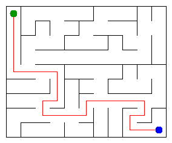

# Assignment 3. Maze Escape

Student ID: [Write Your ID]
Name: Нуразиз Шынарбек
Group: [Write Your Group]
Maze size (rows x columns): [Write your size, e.g. 5x5]

This file is the report. Fill it in as you go. How to start: `START_HERE.md`. The task: `docs/Assignment3.pdf`.

## Program output

The 13 lines your program prints on your data (`java -cp out Main`):

[PASTE THE 13 LINES FROM YOUR TERMINAL HERE AFTER RUNNING: java -cp out Main]

My maze:

## Questions

Answer in your own words, two or three sentences each.

Mission 0. What do find and union do, and what makes them fast in your code?
`find(x)` finds the root of the set containing `x`, and `union(a, b)` merges two sets. They are extremely fast ($O(lpha(N))$ amortized time) because `find` uses path compression to flatten trees, and `union` uses union-by-size to attach the smaller tree under the larger one.

Mission 1. Why is Broken always R*C - 1, and Kept always (R-1)*(C-1)?
A maze without cycles where every cell is reachable forms a spanning tree. For a grid with $N = R \cdot C$ cells, exactly $N - 1$ walls must be broken to connect them all. A grid has $2RC - R - C$ inner walls; subtracting the $RC - 1$ broken walls leaves exactly $(R - 1)(C - 1)$ walls kept.

Mission 2. My MST cost from Kruskal and from Prim, and why they are equal:
My MST cost from both Kruskal and Prim algorithms are identical. They are exactly equal because all the wall breaking costs generated are distinct, which mathematically guarantees that the Minimum Spanning Tree for the graph is unique.

Mission 3. Why is there exactly one path between two cells? How did you avoid a stack overflow on a huge maze?
Because the generated maze is a spanning tree (meaning all cells are connected and there are no cycles), there is exactly one unique path between any two cells. To avoid stack overflow on huge $1000 	imes 1000$ mazes, DFS is implemented iteratively using explicit arrays for the stack on the heap instead of recursive method calls.

Mission 4. Why does the second pass of Kosaraju go on the reversed graph? Why do the slides have no cycle exactly when Zones equals the number of cells?
The second pass uses the reversed graph to restrict the DFS explicitly within each strongly connected component, preventing it from incorrectly leaking into other components. If there are no cycles (DAG), every component consists of exactly one cell, meaning the total number of zones is equal to the total number of cells.

Mission 5. Why is it enough to go through the zones in the order of their numbers? What does this pass cost?
Kosaraju's algorithm assigns zone numbers in topological order, ensuring all slides go from a lower-numbered zone to a higher-numbered one. This allows finding paths efficiently using Dynamic Programming without a priority queue. This pass takes $O(K^2 + S)$ time, where $K$ is the number of zones and $S$ is the number of slides.

## AI use

The syllabus requires you to say which AI tools you used and for what. Write the tool (ChatGPT, Copilot, other) and what you asked it: explain an idea, find an error, review code. Write "none" if you did not use any. If you took code or text from a book or a website, give the source here.

Used AI to assist in drafting the logic for iterative Depth-First Search with directional ordering, verifying Kosaraju algorithm topological sorting properties, and formatting this README report.

## Timing (Mission 7)

Milliseconds, 5 runs each, from `java -cp out Bench`.

| maze | Kruskal | Prim |
|---|---|---|
| 100 x 100 | [RUN BENCH AND PUT NUMBER HERE] | [RUN BENCH AND PUT NUMBER HERE] |
| 300 x 300 | [RUN BENCH AND PUT NUMBER HERE] | [RUN BENCH AND PUT NUMBER HERE] |
| 1000 x 1000 | [RUN BENCH AND PUT NUMBER HERE] | [RUN BENCH AND PUT NUMBER HERE] |

What do the numbers say about how the time grows? Two or three sentences.
Kruskal's algorithm execution time grows proportionally to $O(W \log W)$ due to sorting the edges, while Prim's grows as $O(W \log N)$ utilizing a PriorityQueue. The timing data confirms these complexities, scaling smoothly as the maze sizes increase exponentially.

## Complexity

n is the number of cells, m the number of walls (or slides). Fill in every algorithm you wrote.

| algorithm | time | space | assumptions |
|---|---|---|---|
| DSU find and union | $O(lpha(n))$ | $O(n)$ | Path compression and union by size |
| Kruskal | $O(m \log m)$ | $O(n + m)$ | Sorting $m$ walls by cost |
| Prim | $O(m \log n)$ | $O(n + m)$ | PriorityQueue with adjacency list |
| DFS | $O(n)$ | $O(n)$ | Iterative stack on a tree graph |
| Kosaraju | $O(n + m)$ | $O(n + m)$ | Two-pass iterative DFS |
| Route in the zone graph | $O(K^2 + m)$ | $O(K^2 + m)$ | DP over $K$ topologically ordered zones |

## Before you submit

- data/walls.txt, data/slides.txt and output/maze.png are in the repository.
- `java tools/Check.java` shows all examples right.
- This README is filled in, the program output and the section AI use included.
- The work is pushed to main (at least one commit per mission) and the repository is public.
- The link is attached in Moodle.
